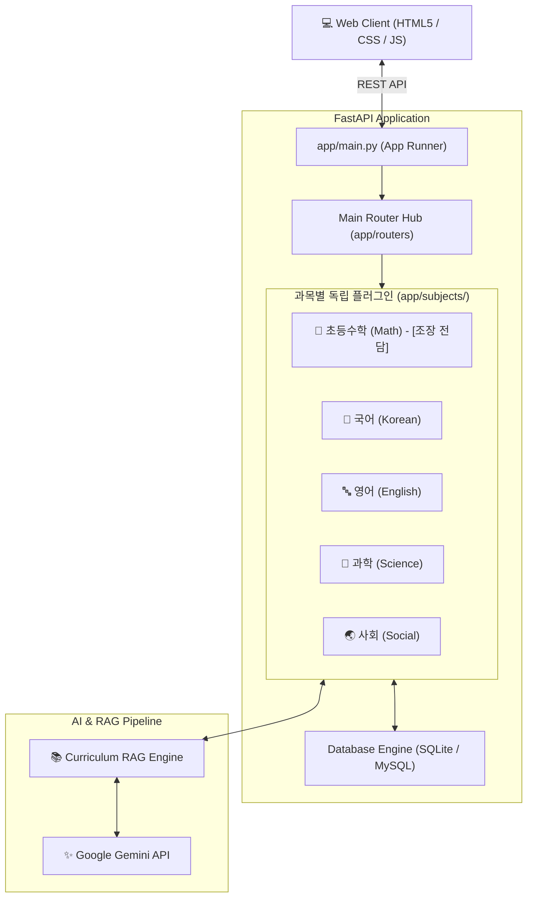

# 🎓 EduMate AI (에듀메이트 AI)
> **다분야 단원 목차 체계 기반 AI 맞춤형 튜터 & 온디맨드 퀴즈 플랫폼**

---

## 📌 1. 프로젝트 개요 (Overview)
**EduMate AI**는 경직된 단순 O/X 채점과 정형화된 문제 풀이에서 벗어나, 교육과정 표준 단원 목차 체계에 맞춘 **AI 개념 설명 · 실시간 온디맨드 문제 출제 · 서술형 문맥 정밀 평가**를 제공하는 차세대 맞춤형 AI 학습 플랫폼입니다.

- **개발 기간**: 2026.10 ~ 진행 중
- **팀 구성**: 팀 프로젝트 (조장: 공통 아키텍처 조율 및 초등수학 전담)
- **핵심 목표**:
  1. 공통 뼈대(Core) 위에 과목별 AI 파이프라인이 결합되는 **플러그인형 아키텍처** 구현
  2. Google Gemini 기반 4대 문제 유형(OX, 4지선다, 단답형, 서술형) 온디맨드 동적 출제
  3. AI 자체 복잡도 판정에 따른 1·3·5 난이도 차등 배점
  4. 서술형 문맥 분석을 통한 1~5점 세부 부분 점수 및 1:1 맞춤형 원포인트 피드백

---

## 🏗️ 2. 시스템 아키텍처 (Architecture)



---

## 🛠️ 3. 기술 스택 (Tech Stack)

| 구분 | 기술 | 설명 |
| :--- | :--- | :--- |
| **Frontend** | HTML5, CSS3, JavaScript, Tailwind CSS | 반응형 학습자 UI, 4대 문제 유형별 동적 인터페이스 |
| **Backend** | Python 3.10+, FastAPI, Uvicorn | 비동기 고성능 RESTful API 서버, 플러그인 모듈 중계 |
| **Database** | SQLite / MySQL, SQLAlchemy | 회원 정보, 과목별 퀴즈 풀이 로그, 단원별 점수 집계 |
| **AI / LLM** | Google Gemini API (gemini-1.5 / gemini-2.0) | 실시간 온디맨드 출제, 서술형 문맥 정밀 채점 |
| **RAG / Search** | 단원 커리큘럼 기반 경량 RAG | 표준 교육과정 단원 목차 파싱 및 수준별 프롬프트 주입 |
| **Cooperation** | Git, GitHub | 보안 방어벽(.gitignore) 기반 안전한 형상 관리 |

---

## 💡 4. 핵심 기능 상세 (Key Features)

### ① AI 온디맨드 4대 유형 출제 & 1·3·5 난이도 시스템
- **OX 퀴즈**: 핵심 개념의 진위 판별 (기초 다지기)
- **객관식(4지선다)**: 실전 개념 적용 및 선지 판별
- **단답형 주관식**: 핵심 수치, 키워드, 공식 입력
- **서술형**: 풀이 과정 기술 및 논리적 서술
- **AI 난이도 배점**: 하(1점), 중(3점), 상(5점) 자동 책정

### ② 서술형 정밀 문맥 채점 & 1~5점 부분 점수
- 단순 정답 키워드 매칭이 아닌 답안의 논리적 흐름과 원리 반영도를 분석
- **부분 점수 체계**: 0점(오답)부터 5점(만점)까지 5단계 차등 점수 부여
- **원포인트 피드백**: 감점 사유와 올바른 풀이 방향을 초등학생 눈높이에 맞춰 친절히 안내

### ③ 교육과정 계층형 단원 연동 (초등수학)
- 학년군(1~2학년, 3~4학년, 5~6학년) 및 대단원/세부주제 선택형 출제
- 학습자 맞춤형 모드 지원 (취약 단원 및 과거 오답 로그 기반 타겟팅)

---

## 📂 5. 프로젝트 디렉토리 구조 (Directory Structure)

```text
edumate_project/
├── .gitignore              # 보안 파일(.env, *.db) 및 캐시 제외
├── requirements.txt        # 프로젝트 의존성 라이브러리 목록
├── main.py                 # FastAPI 메인 서버 구동 엔트리포인트
├── README.md               # 프로젝트 안내 및 기술 문서
│
├── app/
│   ├── core/               # 공통 설정 및 DB 연결
│   ├── models/             # 공통 데이터베이스 모델
│   ├── schemas/            # 공통 Pydantic 요청/응답 규격 (DTO)
│   ├── routers/            # 메인 라우터 조립부
│   └── subjects/           # 과목별 독립 플러그인 구역
│       ├── math/           # [조장 전담] 초등수학 출제/채점/RAG 파이프라인
│       │   ├── router.py
│       │   ├── service.py
│       │   ├── curriculum.txt
│       │   └── quiz_logs.py
│       ├── korean/         # 국어 플러그인
│       ├── english/        # 영어 플러그인
│       ├── science/        # 과학 플러그인
│       └── social/         # 사회 플러그인
│
├── web/                    # 공통 프론트엔드 정적 파일 및 템플릿
│   ├── static/             # 이미지, 스타일시트, JS
│   └── templates/          # Jinja2 HTML 템플릿
│
└── data/                   # 로컬 데이터 (edumate.db 등, git 제외)
```

---

## 👥 6. 팀원 역할 및 담당 영역 (Team Roles)

| 역할 | 담당자 | 전담 영역 및 상세 업무 |
| :--- | :---: | :--- |
| **조장 / 리드 개발** | **조장** | • 공통 FastAPI 백엔드 뼈대 설계 및 라우터 플러그인 표준 규격 수립<br>• **[초등수학]** 전담: 4대 유형 온디맨드 출제, 서술형 문맥 채점, 커리큘럼 RAG |
| **팀원 (국어)** | 조원 A | • **[국어]** 전담: 어휘/독해/문법 퀴즈 출제 및 서술형 피드백 파이프라인 |
| **팀원 (영어)** | 조원 B | • **[영어]** 전담: 파닉스/기초 문법/영작 퀴즈 출제 및 발음/문맥 채점 |
| **팀원 (과학)** | 조원 C | • **[과학]** 전담: 탐구 실험/기초 과학 개념 퀴즈 출제 및 원리 채점 |
| **팀원 (사회)** | 조원 D | • **[사회]** 전담: 역사/지리/시사 퀴즈 출제 및 지도/시각자료 연동 |

---

## 🚀 7. 시작하기 (Getting Started)

### 1) 환경 설정 및 패키지 설치
```bash
# 가상환경 생성 및 활성화
python -m venv venv
# Windows
venv\Scripts\activate

# 패키지 설치
pip install -r requirements.txt
```

### 2) 환경 변수 설정
프로젝트 루트에 `.env` 파일을 생성하고 Gemini API 키를 등록합니다.
```env
GEMINI_API_KEY=your_gemini_api_key_here
```

### 3) 서버 실행
```bash
python main.py
```
브라우저에서 `http://localhost:8000`으로 접속하여 학습 플랫폼을 이용할 수 있습니다.
