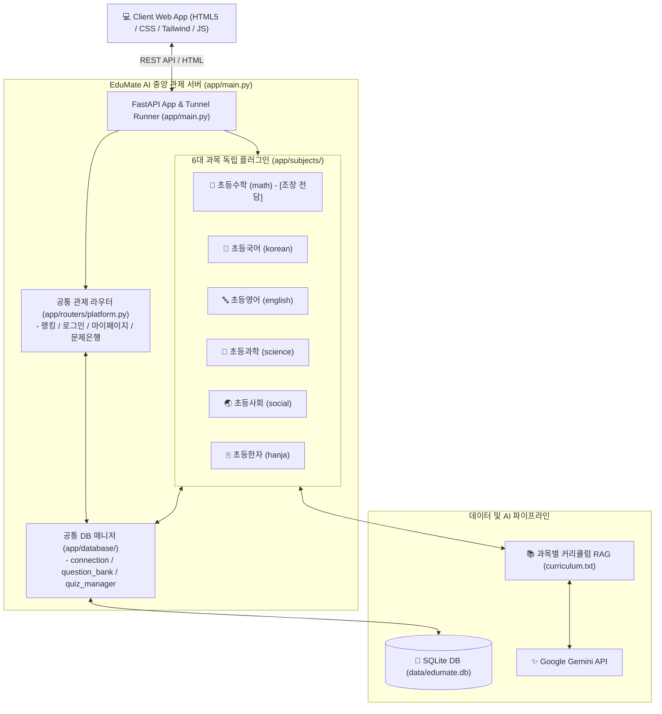

# 🎓 EduMate AI (에듀메이트 AI)
> **다분야 단원 목차 체계 기반 AI 맞춤형 튜터 & 온디맨드 퀴즈 통합 관제 플랫폼**

---

## 📌 1. 프로젝트 개요 (Overview)
**EduMate AI**는 경직된 단순 O/X 채점과 정형화된 문제 풀이에서 벗어나, 교육과정 표준 단원 목차 체계에 맞춘 **AI 개념 설명 · 실시간 온디맨드 문제 출제 · 서술형 문맥 정밀 평가**를 제공하는 차세대 맞춤형 AI 학습 플랫폼입니다.

- **버전**: v1.07 (통합 포털 & 6대 과목 플러그인 관제 시스템)
- **개발 기간**: 2026.10 ~ 진행 중
- **팀 구성**: 팀 프로젝트 (조장: 공통 아키텍처 수호 & 초등수학 전담, 조원: 과목별 플러그인 전담)
- **핵심 목표**:
  1. 공통 통합 포털 백엔드(`app/`) 위에 과목별 AI 파이프라인이 자동 조립되는 **독립 플러그인형 아키텍처**
  2. Google Gemini 기반 4대 문제 유형(OX, 4지선다, 단답형, 서술형) 온디맨드 동적 출제
  3. AI 자체 문제 복잡도 판정에 따른 1·3·5 난이도 차등 배점
  4. 서술형 문맥 분석(Semantic Evaluation)을 통한 1~5점 정밀 부분 점수 및 1:1 맞춤형 원포인트 피드백
  5. 포켓몬 등급제 & 통합 명예의 전당 랭킹 시스템을 통한 학습 동기 부여

---

## 🏗️ 2. 시스템 아키텍처 (Architecture)



---

## 🛠️ 3. 기술 스택 (Tech Stack)

| 구분 | 기술 스택 | 설명 |
| :--- | :--- | :--- |
| **Frontend** | HTML5, CSS3, JavaScript, Tailwind CSS, Jinja2 | 반응형 통합 포털 로비, 공통 마이페이지, 4대 문제 유형별 동적 인터페이스 |
| **Backend** | Python 3.10+, FastAPI, Uvicorn | 비동기 고성능 RESTful API 중앙 관제 서버, 과목 플러그인 자동 마운트 |
| **Database** | SQLite (SQLAlchemy / Python Native) | 회원 정보, 과목별 퀴즈 풀이 로그(`quiz_logs`), 문제은행 관리 |
| **AI / LLM** | Google Gemini API (gemini-1.5 / gemini-2.0) | 실시간 온디맨드 4대 유형 출제, 서술형 1~5점 문맥 정밀 채점 |
| **RAG / Search** | 단원 커리큘럼 기반 경량 RAG | 표준 교육과정 단원 목차 파싱 및 수준별 맞춤 프롬프트 주입 |
| **DevOps & Net** | Cloudflared Tunnel, Git / GitHub | 외부 공유 터널 자동 연동, 보안 방어벽(`.gitignore`) 기반 형상 관리 |

---

## 📂 4. 실제 프로젝트 디렉토리 구조 (Directory Structure)

```text
aisproject/
├── .gitignore                    # 보안 파일(.env, *.db, *.log) 완벽 차단
├── requirements.txt              # 프로젝트 의존성 라이브러리 목록
├── README.md                     # 프로젝트 공식 기술 및 포트폴리오 문서
├── sample.md                     # 초기 프로젝트 참조 문서
│
├── app/                          # [백엔드 패키지 - 중앙 관제 서버]
│   ├── main.py                   # ⭐ 서버 구동 단일 엔트리포인트 (FastAPI & Uvicorn & 터널)
│   ├── config/                   # 환경 설정 모듈
│   ├── database/                 # 공통 데이터베이스 엔진
│   │   ├── connection.py         # DB 커넥션 풀 관리
│   │   ├── question_bank_manager.py # 문제은행 CRUD 매니저
│   │   └── quiz_manager.py       # 퀴즈 풀이/채점 및 점수 집계 매니저
│   ├── models/                   # 데이터베이스 ORM 엔티티 모델
│   ├── schemas/                  # 공통 Pydantic 요청/응답 규격 (DTO)
│   ├── routers/                  # 공통 관제 라우터
│   │   └── platform.py           # 로그인, 랭킹 집계, 마이페이지 API
│   │
│   └── subjects/                 # 6대 과목 독립 플러그인 구역
│       ├── math/                 # ⭐ [조장 전담] 초등수학 출제/채점/RAG 파이프라인
│       │   ├── router.py         # 수학 라우터 (대단원/소단원 선택 및 퀴즈 API)
│       │   ├── service.py        # Gemini API 연동 출제 및 서술형 채점 로직
│       │   ├── curriculum.txt    # 2022 개정 초등수학 교육과정 단원 목차
│       │   └── quiz_logs.py      # 수학 풀이 로그 DB 기록
│       ├── korean/               # 초등국어 플러그인
│       ├── english/              # 초등영어 플러그인
│       ├── science/              # 초등과학 플러그인
│       ├── social/               # 초등사회 플러그인
│       └── hanja/                # 초등한자 플러그인
│
├── web/                          # [프론트엔드 정적 파일 & 템플릿]
│   ├── static/                   # 공통 로고, 포켓몬 등급 이미지(.webp), CSS/JS
│   └── templates/                # Jinja2 템플릿
│       ├── index.html            # 통합 포털 로비 (6개 과목 허브 & 명예의 전당)
│       └── mypage.html           # 공통 마이페이지 & 오답노트 & 랭킹 관리
│
├── sample/                       # [팀원 복사용 공용 샘플 템플릿]
│   ├── quiz_logs.py              # 과목별 풀이 로그 함수 표준 샘플
│   └── edumate_logo.svg          # 공식 로고 이미지
│
├── tests/                        # 테스트 코드 모음
└── data/                         # 로컬 데이터 (edumate.db / git 제외 보호)
```

---

## 👥 5. 팀원 역할 및 전담 과목 배정표 (Team Roles)

| 과목 / 역할 | 담당자 | 전담 영역 및 상세 구현 내용 |
| :--- | :---: | :--- |
| **조장 / 리드 개발** | **조장** | • **공통 뼈대 수호**: `app/` 중앙 관제 서버, 라우터 자동 조립 및 DB 규격 통일<br>• **[초등수학] 전담**: 4대 유형 출제, 1·3·5 난이도 배점, 1~5점 서술형 문맥 채점, 학년군 커리큘럼 RAG |
| **초등국어** | 조원 A | • 어휘/독해/문법 온디맨드 퀴즈 출제 및 서술형 원포인트 첨삭 피드백 |
| **초등영어** | 조원 B | • 파닉스/기초 어휘/문법 퀴즈 출제 및 영작 문맥 채점 |
| **초등과학** | 조원 C | • 탐구 실험/기초 과학 개념 퀴즈 출제 및 원리 기반 서술형 채점 |
| **초등사회** | 조원 D | • 역사/지리/시사 퀴즈 출제 및 시각자료/지역 이미지 연동 |
| **초등한자** | 조원 E | • 급수별 한자 퀴즈, 훈음 판별 및 사자성어 단답/서술형 출제 |

---

## 💡 6. 핵심 기능 및 차별점 (Key Features)

### ① AI 온디맨드 4대 유형 출제 & 1·3·5 난이도 시스템
- **OX 퀴즈**: 핵심 개념 진위 판별 (기초 점검)
- **객관식(4지선다)**: 실전 개념 적용 및 선지 판별
- **단답형 주관식**: 핵심 수치, 키워드, 공식 입력
- **서술형**: 풀이 과정 기술 및 논리적 서술
- **AI 자체 난이도 판정**: 하(1점), 중(3점), 상(5점) 자동 책정

### ② 서술형 정밀 문맥 채점 (Semantic Evaluation)
- 단순 정답 키워드 일치 여부를 넘어, 답안의 논리적 흐름과 원리 반영도를 분석
- **0점~5점 5단계 차등 점수**: 노력 점수부터 완벽한 서술까지 공정하게 배점
- **원포인트 피드백**: 초등학생 눈높이에 맞춘 1~2문장의 감점 사유 및 올바른 풀이 안내

### ③ 교육과정 계층형 단원 연동 (초등수학)
- 학년군(1~2학년, 3~4학년, 5~6학년) 선택 시 `curriculum.txt` 부분 슬라이싱 파싱 (토큰 최적화)
- 대단원 / 세부주제 계층형 드롭다운 선택 출제
- 학습자 맞춤형 모드 지원 (과거 오답 로그 기반 취약 단원 우선 출제)

---

## 🚀 7. 실행 방법 (Getting Started)

### 1) 환경 설정 및 라이브러리 설치
```bash
# 가상환경 생성 및 활성화
python -m venv venv
# Windows: venv\Scripts\activate
# Mac/Linux: source venv/bin/activate

# 의존성 패키지 설치
pip install -r requirements.txt
```

### 2) 환경 변수 설정
프로젝트 루트에 `.env` 파일을 생성하고 Gemini API 키를 입력합니다.
```env
GEMINI_API_KEY=your_gemini_api_key_here
```

### 3) 서버 실행 (단일 정석 엔트리포인트)
```bash
# app/main.py 단일 엔트리포인트로 서버 가동 (터널 및 Uvicorn 자동 실행)
python app/main.py
```
- **로컬 접속 주소**: `http://127.0.0.1:8000`
- **초등수학 바로가기**: `http://127.0.0.1:8000/math/`
- **마이페이지 바로가기**: `http://127.0.0.1:8000/mypage`
